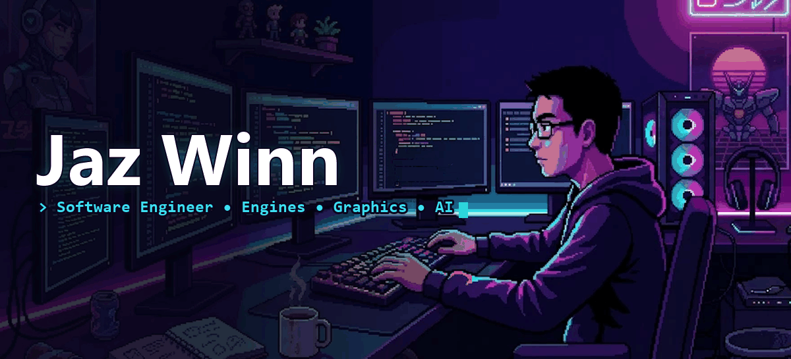

<!-- ======================= HEADER ======================= -->


<div align="center">

<a href="https://git.io/typing-svg">
  
</a>

<br/>

<a href="https://jazwinn.github.io/Jaz-Portfolio/"></a>
<a href="https://www.linkedin.com/in/jazwinn-ng/"></a>
<a href="https://mail.google.com/mail/?view=cm&to=ngjazwinn@gmail.com"></a>
<a href="https://www.instagram.com/jaz_winn/"></a>

</div>


##  About Me

```cpp
struct JazWinn {
    std::string role      = "Software Engineer";
    std::string builds    = "high-performance systems";

    std::vector<std::string> shipped = {
        "real-time C++20 3D engine (ECS, reflection, PhysX)",
        "LLM inference engine (C++20 + CUDA)",
        "real-time computer vision pipelines",
    };

    std::vector<std::string> exploring = {
        "LLMs", "Computer Vision", "Machine Learning"
    };

    std::vector<std::string> offline = {
        "running 🏃", "gym 💪", "making games 👾"
    };
};
```

- 🎮 I build **engines from the ground up** — renderers, Entity Component Systems, compile-time reflection, asset pipelines
- ⚡ I write **inference code with no ML frameworks** — tokenizer to KV cache to CUDA kernels
- 📷 I ship **computer vision tools** that run in real time on a single consumer GPU
- 💬 Open to **software engineering, graphics, and AI/ML roles** — [let's talk](https://www.linkedin.com/in/jazwinn-ng/)


## 🚀 Featured Projects

<table>
<tr>
<td width="50%" valign="top">

### 🧠 [InferenceEngine](https://github.com/jazwinn/InferenceEngine)
Transformer inference engine written **from scratch in C++20** with zero ML dependencies. Loads Hugging Face `.safetensors`, runs its own tokenizer and chat templates, and generates on CPU or through a **custom CUDA backend**. Chats with **Llama 3.2 1B** end to end.


</td>
<td width="50%" valign="top">

### 🎮 [KosEngine 2.0](https://github.com/jazwinn/Kos-Engine-2.0)
Modular, high-performance **real-time C++20 3D engine**. **ECS architecture**, **compile-time reflection**, C++ scripting, **PhysX** physics, an asset system, and automated testing with GoogleTest in CI.


</td>
</tr>
<tr>
<td width="50%" valign="top">

### 🎯 [OneShotSeg](https://github.com/jazwinn/OneShotSeg)
Segment and track **any object from a single drawn box** — no training data, no labels, no fine-tuning. FastSAM + OSNet Re-ID tracking, **real time on one consumer GPU**.


</td>
<td width="50%" valign="top">

### 🔀 [AdaptiveVisionPipeline](https://github.com/jazwinn/AdaptiveVisionPipeline)
Object detection that **watches its own performance** — a meta-controller reads motion, blur, lighting and confidence signals and **switches detection pipelines in real time**.


</td>
</tr>
<tr>
<td width="50%" valign="top">

### 🏷️ [Groundwork](https://github.com/jazwinn/Groundwork)
Label datasets and **train CV models from the browser**, fully local. Uses **SAM 3** for zero-shot auto-labelling and **Ultralytics YOLO** for training, export and ONNX conversion.


</td>
<td width="50%" valign="top">

### 💪 [ELISS Push-Up Counter](https://github.com/jazwinn/OpenCV-ELISS-PushUpCounter)
Push-up assistant inspired by Singapore's **ELISS** machine — **YOLO pose estimation**, OpenCV, and custom biomechanics logic to judge every rep.


</td>
</tr>
</table>

<details>
<summary><b>🗂️ More projects</b></summary>
<br/>

| Project | What it does | Stack |
|---|---|---|
| [Graphics-Engine](https://github.com/jazwinn/Graphics-Engine) | Ongoing graphics engine library | C++ · OpenGL |
| [BVH Spatial Data Structure](https://github.com/jazwinn/Spatial-Data-Structure-using-Bounding-Volume-Hierarchy-BVH-) | Faster 3D rendering with a Bounding Volume Hierarchy | C++ |
| [Kd-Tree Raytracing](https://github.com/jazwinn/Spatial-Data-Structure-using-Kd-Tree-for-Raytracing) | Accelerating a raytracer with a Kd-tree | C++ |
| [Procedural Cave Generation](https://github.com/jazwinn/Procedural-Cave-Generation) | Comparing procedural algorithms for cave systems | C++ |
| [OptimizedTransformerLayer](https://github.com/jazwinn/OptimizedTransformerLayer) | Transformer layer optimized for local hardware | Python |
| [Server-Client File Sharing](https://github.com/jazwinn/Server-Client-file-sharing) | TCP client/server with UDP file transfer | C++ |
| [React Stock Viewer](https://github.com/jazwinn/React-Web-Stock-Viewer) | Stock prices, news and AI summaries | React · Node · Tailwind |
| [Inventory Web App](https://github.com/jazwinn/Inventory-Web-Application) | Full-stack CRUD with a REST API | Java · Spring Boot · SQL |
| [RepoToTDD](https://github.com/jazwinn/RepoToTDD) | Generates a technical design doc from a repo | Python |

</details>


## 🛠️ Tech Stack

<div align="center">

<p align="center">
  
</p>

<p align="center">
  
  
  
  
</p>

</div>

<!-- GitHub Activity (hidden)


## 📊 GitHub Activity

<div align="center">


<picture>
  <source media="(prefers-color-scheme: dark)" srcset="https://raw.githubusercontent.com/jazwinn/jazwinn/output/github-snake-dark.svg" />
  <source media="(prefers-color-scheme: light)" srcset="https://raw.githubusercontent.com/jazwinn/jazwinn/output/github-snake.svg" />
  
</picture>

</div>
-->

<!-- ======================= FOOTER ======================= -->

